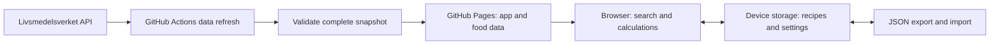

# Foodie implementation plan

Planning date: 2026-10-24. Status: implementation authorized by the user's request to build with Sol and Luna. Nordic Cookbook was selected on the design board. This document records the implementation brief; current verification and deployment status are reported separately.

## Outcome

An everyday user can find a food, understand its nutrients per 100 g or their own quantity, and return to search without losing context. A home cook can later combine food quantities into a recipe, inspect totals and per-serving values, and save the recipe locally.

The primary surface is an **Operate** interface: useful search and readable data lead immediately. Swedish is the initial language; English is equally complete. One responsive web app serves phones, tablets, and desktop browsers.

## Architecture decision: no running backend for stages one and two

Use React, TypeScript and Vite on GitHub Pages. A build-time data job reads Livsmedelsverket's API and produces a validated, versioned static dataset. The browser searches an index locally, loads a selected food's nutrients from the same site, calculates quantities, and stores user recipes on the device.



Why: the observed catalogue has 2,606 foods, small enough to search locally. Publishing data with the app removes upstream latency and CORS from the everyday lookup path. Static hosting suits both stages; a scheduled build job is not a continuously running backend. Direct API calls are technically plausible based on sampled CORS responses, but they add an avoidable availability dependency.

Tradeoff: displayed data is a dated snapshot, not guaranteed to match the upstream API in real time. Show the snapshot date and source, and keep the last complete snapshot if refresh fails. The app must not claim that scheduled updates always succeed.

A backend or hosted service becomes useful only for accounts/synchronization, shared editable recipes, private provider keys, or protected paid API usage. GitHub Pages continues to host the frontend if such a service is added later.

## Stage one: food lookup

Ship together:

- Search both Swedish and English food names, irrespective of interface language. Rank exact phrase, prefix, then all-word matches; offer accent-insensitive fallback while retaining the original spelling. Use local relevance ordering, not an API request on each keystroke.
- Keep complete names and preparation terms visible: raw and cooked foods are different records. Search result links open stable food IDs.
- Detail page: name, quantity input in grams, energy in kcal and kJ, protein, available carbohydrate, total fat, fibre, sugars and salt when available. Secondary nutrients appear in grouped, expandable tables.
- Default quantity is 100 g of edible portion. Offer 50 g, 100 g and 200 g presets plus a custom decimal input. Do not invent a gram weight for “one apple,” a cup, or a tablespoon.
- A labelled donut/pie chart shows the relative gram amounts of protein, available carbohydrate and total fat only. The adjacent legend and table remain usable without the chart.
- Source attribution, license link, food version and snapshot date, plus a short explanation of quantity and chart basis.
- Swedish/English UI, food names and nutrient names; light, dark and system appearance. Offer two accent palettes through shared tokens, not separate page implementations. Save preferences locally.
- Recent foods and favourites on the device, with a clear action to remove them. These are small convenience features after the core search works.
- Shareable food links, browser Back behaviour, loading/empty/error states, and keyboard access.

Do not put a nonfunctional Recipes tab in the first release. Add the navigation item when stage two is ready.

## Stage two: recipe builder

Reuse food search, nutrient normalization, quantity scaling, chart and tables.

- Create a named recipe; add a food by ID and edible weight in grams; edit quantities; remove ingredients with undo.
- Display total recipe nutrients, nutrients per serving, and per 100 g of the ingredient mixture. User sets a positive integer number of servings.
- Keep each food's full raw/cooked description. For a first release of the builder, calculate an ingredient-mixture estimate; do not silently apply cooking losses, retention factors, or volume conversions.
- Optionally accept a measured final dish weight. This changes the per-100-g denominator only, with explicit copy that nutrient losses are not modeled. Total nutrients remain the sum of the entered ingredients.
- Show incomplete nutrient coverage. If an ingredient lacks a nutrient, show the known subtotal as incomplete instead of presenting an exact total.
- Autosave locally using IndexedDB; show unsaved/error state if persistence fails. Save recipe schema version and the data snapshot used for the calculation.
- Duplicate, rename, delete with undo, export and import JSON. Import validates before changing storage, previews records, and offers merge/copy/replace explicitly. Keep a backup before replacement and never silently overwrite an existing recipe with the same ID.
- Recipe updates must not silently change historical calculations: store a compact nutrient snapshot for each ingredient. Offer an explicit “Update food data” action with a change summary when newer data is available.

Suggested initial limits: 100 ingredients per recipe; import file up to 5 MB. These are implementation guardrails to validate in testing, not confirmed product promises.

## Screen behaviour and responsive layout

### Search and food detail

Desktop: compact top navigation; prominent search above results; results at left and selected-food details in a wider right pane. Search remains accessible while exploring foods. A direct food link opens the detail even without a preceding query.

Mobile: search and results form the first screen. Selecting a food opens a full detail route with a clear back-to-results action, preserved query and scroll position. Avoid a cramped side drawer for the primary task. Keep the portion input near the nutrient summary. Tables reflow without horizontal page scrolling.

Initial state: search prompt and real recent/favourite foods when present; otherwise short examples of searches. Never show fabricated nutrition results as actual data. Empty search results explain how to adjust the query. Missing food IDs offer a route back to search.

Selecting a different food must never briefly show the previous food's numbers under the new name. Use request cancellation or a selection ID check. Announce loading and result counts without announcing every nutrient update on every keypress.

### Recipe builder

Desktop: editable ingredient list with a persistent summary alongside it. Mobile: ingredient list followed by summary; a compact jump-to-summary control may help, but must not cover fields or the software keyboard. Reuse food search for an inline add-ingredient flow, retaining the recipe draft.

### Selected visual direction

Binding requirements: modern, colourful, readable, bilingual, themed and responsive. The user selected **Nordic Cookbook** on the direction board: warm oat surfaces, deep green, berry and ochre accents, editorial headings and precise numerical typography. Keep conventional web controls and visible data hierarchy.

The signature interaction is coordinated chart/legend highlighting, available on focus and tap as well as hover. Quantity changes update displayed amounts immediately; chart proportions should remain unchanged when all three macros scale equally. Respect reduced motion and keep useful content visible without entrance animations.

Theme changes must preserve nutrient identities and contrast. Do not use colour as the sole indicator of selection, errors or nutrient series. Static direction sketches guide composition; the shipped design system is documented from the implementation in DESIGN.md.

## Data acquisition and refresh

Use the API base and schema recorded in docs/API-RESEARCH.md. No undocumented search parameter and no hard-coded record count.

1. Fetch API information and paginate the catalogue in both languages. Start conservatively with 100 records per page; respect returned counts, handle empty pages, and verify the final unique-ID count against metadata. Join languages by food number, not array position.
2. Fetch nutrient records for each food in both languages on the initial import. Keep requests bounded, initially sequential, with retry/backoff and Retry-After support for throttling. Do not issue thousands of requests at once.
3. On later refreshes, reuse unchanged records by upstream food version, but perform a full verification refresh periodically because version semantics have not been proven to cover every field. Stop on schema drift or invalid values; log a useful error without publishing partial data.
4. Normalize to a single internal nutrient schema while preserving original units, matrix/basis metadata and source status codes. Retain a small source-fixture set for regression tests. Review any unknown nutrient identity or conflicting language values.
5. Produce a compact bilingual search index, a nutrient dictionary, a snapshot manifest, and per-food detail JSON. Keep large analysis/reference prose out of the search index. Do not duplicate every nutrient label in every row.
6. Validate all referenced IDs/files, uniqueness, numeric finiteness, locale fallback, canonical nutrient mappings and completeness before publishing a snapshot.
7. Keep normalized snapshots under version control initially if measured size is reasonable. Refresh through a dedicated Action that proposes a data-update PR; use manual dispatch plus a monthly schedule. Normal application builds use the checked-in snapshot and never require a successful live API call.
8. Merge a validated snapshot and deploy the app and data together. The currently deployed version stays available if refresh/build fails. Display snapshot version/date in the app. Monitor failed runs; scheduled Actions may be disabled after prolonged repository inactivity.

GitHub Pages has no custom server routes. Use hash routes such as `/#/search?q=havre` and `/#/food/1?grams=150`; under a project site they become `/foodie/#/...`. Use Vite's base URL for assets and data fetches. Keep a small manifest URL revalidated on navigation; data files use snapshot-versioned paths. On an old-tab missing-file error, offer to reload the newer dataset and preserve drafts first.

## Calculation and chart rules

- Define nutrient identity by **EuroFIR code + normalized unit + normalized measurement basis**. `ENERC` occurs in both kcal and kJ; never overwrite one with the other. Display names and abbreviations are localized and are not stable keys.
- Whitelist the key measures: `PROT`/g, `CHO`/g, `FAT`/g, `FIBT`/g, `SUGAR`/g, `NACL`/g, and `ENERC`/kcal and /kJ, all on an established per-100-g edible-food basis. Map all other nutrients conservatively and preserve unfamiliar rows.
- The schema says `viktGram` is always 100, but some sampled rows omit matrix metadata. Normalize those only through an explicit documented default rule based on that schema; preserve that the matrix was unspecified. Do not scale explicit alternative bases, ratios or percentages as if they were food mass.
- Food quantity: `amount = sourcePer100g * edibleGrams / 100`.
- Recipe total: sum quantity-adjusted values of the same nutrient identity. Per serving: total divided by servings. Per 100 g: total multiplied by 100 divided by the declared mixture/final weight.
- Use source-provided energy. Do not recalculate headline calories from macro amounts or round each ingredient before summing.
- Missing/absent/invalid values remain unknown, never zero. Genuine zero remains zero. Preserve source qualifiers; do not invent the meaning of unverified status codes.
- Donut slices: protein grams, available carbohydrate grams, total fat grams. Denominator is their sum, not food weight or total energy. Label “Macro composition by weight” / “Fördelning av makronäringsämnen efter vikt”, with supporting copy that water, fibre, alcohol and other components are excluded. Sugar is a carbohydrate subset and is not an extra slice; saturated fat is not added alongside total fat.
- If all three macros are zero, show a neutral empty chart with a textual explanation; if one is missing, show an unavailable chart plus the known values. Never draw a misleading full pie for incomplete data. A later energy-share chart requires a separately specified energy model.
- Accept decimal comma or decimal point for quantities; reject ambiguous separators, negatives, infinity and non-numeric input. Preserve temporary edit strings while typing; only calculate valid values. Zero quantity can be shown as zero in food lookup; recipe ingredients require positive grams. Keep full precision internally and format using locale-aware numbers.

## Suggested implementation structure

Keep one app and a small set of pure domain modules. Use existing React state/context first; avoid a global state framework unless measured needs justify it. Use a lightweight SVG donut with a semantic legend rather than a large chart suite for one chart type.

```text
src/
  app/                 routing, layout, providers
  components/          controls, status messages, accessible chart
  features/search/     search input, result list, favourites
  features/food/       food detail, quantity, nutrient table
  features/recipes/    stage-two editor and library (lazy-loaded)
  features/settings/   language, appearance, data/source information
  domain/              food types, normalization, scaling, recipes
  data/                static dataset repository and validation
  storage/             preferences and IndexedDB recipe adapter
  i18n/                sv/en messages and number parsing/formatting
  styles/              semantic theme tokens and shared styles
scripts/               API sync and snapshot validation
data/                  checked-in normalized snapshot and manifest
tests/fixtures/        small recorded API samples and synthetic math cases
```

Suggested tooling: strict TypeScript, npm lockfile, ESLint, Vitest for domain tests, Testing Library for key form interactions, Playwright for end-to-end and accessibility checks. Select supported package versions at implementation time; this document does not pin unverified versions.

## Speed, accessibility and localization acceptance criteria

These are targets to measure, not claims about an unbuilt app.

- Target initial JavaScript at or below 180 KB gzip and CSS at or below 35 KB gzip. Exclude food JSON from the JS bundle. Load the recipe editor only when needed.
- Target compact bilingual search index at or below 300 KB gzip; if measurements exceed it, remove unused fields and partition optional data before adding complexity. Fetch details on selection, not all foods at startup.
- After the index is loaded, target search-to-results p95 below 100 ms under representative mobile CPU throttling. Render results in bounded batches, initially 30, with an accessible “show more” action.
- Target LCP <= 2.5 seconds, CLS <= 0.1 and INP <= 200 ms where measurable. Record browser, device/throttling profile, cache state and dataset size with results. Use lab checks before release and distinguish them from field measurements.
- Work from 320 CSS pixels through wide desktop layouts; test 390, 768 and 1440 widths, plus 200% zoom. Touch targets should be at least 44 by 44 CSS pixels. Test iOS Safari and Android Chrome behaviour as well as desktop.
- Target WCAG 2.2 AA: keyboard focus, labels, sensible heading order, sufficient contrast in both themes, live error messages, reduced motion, and text equivalents for charts. Use automated checks plus a manual keyboard pass.
- Translate all interface strings, validation, loading, empty states, chart descriptions and source explanations. Use Swedish and English API names joined by stable ID, with visible fallback if a name is missing. Set document language and use `Intl.NumberFormat` for outputs.
- Language/theme switching preserves food, quantity, query and recipe state. A saved theme preference overrides system appearance; system mode responds to system changes. Keep theme application early enough to prevent a conspicuous wrong-theme flash.
- Storage denied, unavailable or full must leave lookup usable and show recipe persistence failure honestly. JSON import rejects malformed, unsupported-version and oversized payloads without corrupting existing records.

## Useful additions and deliberate later work

High-value after core lookup: compare two foods on the same quantity basis; improved synonym aliases; printable nutrition summary. Add these only after stage-one release acceptance.

After the manual recipe builder: printable recipes, shopping list from recipe ingredients, and optional cached/offline access. A PWA/service worker is optional later work; the first release must not promise offline access simply because it uses local data or browser caching.

Defer barcode/product scanning, meal tracking, accounts, social sharing, recommendations, dietary scores and allergy safety claims. They require separate data or product decisions. Livsmedelsverket's food composition records are not a universal branded-product catalogue.

## Recipe API integration: optional stage three

The manual recipe builder needs no recipe API. For external discovery, prototype TheMealDB first, then decide whether its catalogue and language coverage are sufficient. It offers development/personal access, while its current guide recommends a supporter key for public production use. Its API accessibility does not make every recipe/image unrestricted open data.

Spoonacular and Edamam are alternatives with keys, commercial plans and meaningful quota/caching conditions. Keep private keys behind a separate service; never put them in Vite client variables. Do not mirror these catalogues into the Livsmedelsverket static snapshot without permission.

External recipe import is a review workflow: retain original recipe attribution/link, parse ingredient text, propose Livsmedelsverket matches, ask the user to resolve food identity and gram quantities, then calculate with the confirmed mapping. Terms like “one onion,” “a splash,” raw/cooked state and drained weights prevent reliable automatic matching. English instructions may remain English unless a licensed translation exists. External nutrition values must not be relabelled as Livsmedelsverket values.

See docs/API-RESEARCH.md for source links and provider-specific findings. No recipe provider is selected for production.

## Delivery and review gates

1. Agree the visual direction while Sol implements the data/domain foundation. The architecture proposal and scope can be confirmed with this brief.
2. Complete stage one and release it independently: bilingual lookup, correct calculations, themes, mobile UX, attribution, speed checks and Pages deployment.
3. Add stage two after stage-one acceptance: reliable calculations and device persistence before import/export and polish.
4. Evaluate external recipes only against a working manual builder.

The exact task order, ownership boundaries and copyable Sol/Luna prompts are in docs/BUILD-HANDOFF.md. Repository: mtengmo/foodie, branch main. The private repository initially had no Pages deployment. Preserve repository visibility; verify Pages availability before publication. No extra account/storage decision is needed.
