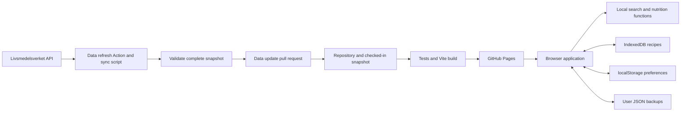

# Implemented architecture

This describes the implementation including nutrient discovery and starter recipes, checked on 2026-10-24. Product intent is in [PRODUCT.md](../PRODUCT.md), visual rules in [DESIGN.md](../DESIGN.md), and working instructions in [DEVELOPMENT.md](DEVELOPMENT.md). Source types and functions remain the exact API contracts.

## System boundary

One client-rendered React application is built by Vite and published to GitHub Pages at `https://foodie.tengmo.com`. GitHub Actions fetches and validates nutrition data separately from ordinary application builds. The browser searches downloaded names, loads selected foods individually, calculates nutrients and stores recipes locally.

There are no server endpoints, authentication, cloud recipe synchronization, service workers or runtime calls to a recipe catalogue. Browser caching does not establish guaranteed offline support.

## Module map

| Location | Current responsibility |
| --- | --- |
| [`src/main.tsx`](../src/main.tsx) | React entry point, StrictMode, local font and stylesheet imports |
| [`src/App.tsx`](../src/App.tsx) | Hash router, screen state, food/recipe/settings UI, charts, optimistic recipe orchestration and update controls |
| [`src/domain/types.ts`](../src/domain/types.ts) | Food, nutrient, dataset, ingredient and recipe contracts |
| [`src/domain/index.ts`](../src/domain/index.ts) | Quantity parsing/scaling, bilingual search, recipe aggregation, macro helpers and recipe creation |
| [`src/data/repository.ts`](../src/data/repository.ts) | Same-origin manifest/index/dictionary/detail loading, promise cache and retry cache reset |
| [`src/domain/discovery.ts`](../src/domain/discovery.ts) / [`src/data/discovery.ts`](../src/data/discovery.ts) | Protein/fibre threshold assessments and lazy snapshot-bound nutrient rankings |
| [`src/data/starter-recipes.ts`](../src/data/starter-recipes.ts) | Six original bilingual templates and validated, frozen local-copy creation |
| [`src/storage/preferences.ts`](../src/storage/preferences.ts) | Language, appearance, accent, favourite IDs and recent IDs |
| [`src/storage/recipes.ts`](../src/storage/recipes.ts) | IndexedDB access, recipe validation, JSON import/export and nutrient comparison |
| [`src/update/`](../src/update/) | Build-version fetching, React update hook and shared reload-safety state |
| [`src/i18n/messages.ts`](../src/i18n/messages.ts) | Shared Swedish/English messages; some screen copy is currently localized inline in App.tsx |
| [`src/styles/global.css`](../src/styles/global.css) | Shared layout, theme tokens, component states and responsive rules |
| [`scripts/`](../scripts/) | Dataset synchronization, validation, safe retention and development screenshot capture |
| [`public/data/`](../public/data/) | Generated, checked-in dataset manifest and versioned snapshots |
| [`tests/`](../tests/) / [`e2e/`](../e2e/) | Domain/data/update tests and production-browser/accessibility flows |

The UI is currently consolidated in App.tsx. The `features/` and component-directory layout in the original plan is a possible refactoring direction, not the current implementation. Prefer incremental extraction around a real change over a wholesale rewrite.

## Dependency direction

UI composes the repository, storage and domain modules. Domain functions do not fetch data, access IndexedDB/localStorage, format localized output or import React. The domain recipe factory uses the browser-compatible `crypto.randomUUID()` and a timestamp; calculation/search functions remain independent of browser state.

The repository loads typed data but does not calculate nutrients. Storage validates and persists recipes but does not render UI. The update client does not import recipe UI; its shared safety module lets the UI register pending work without circular screen dependencies. Build-time ingestion scripts run in Node and never enter the browser bundle.

## Food lookup flow

1. App loads `data/manifest.json`, the bilingual index and nutrient dictionary through `foodRepository`.
2. `searchFoods` matches both names locally using exact, prefix and all-word relevance, with accent-insensitive folding and stable tie-breaking.
3. Selecting a food loads its versioned `detailPath`. Food identity is checked against the requested ID, and App ignores superseded detail responses.
4. `scaleNutrients` adjusts known per-100-g values to the entered edible weight. UI formatting uses the selected locale.
5. The chart represents gram shares of protein, available carbohydrate and total fat. The adjacent controls/table provide textual values and keyboard selection.

The repository caches promises for a page session, removes failed loads from the cache, and revalidates the manifest over HTTP. Retry clears its in-memory cache. Search result pagination exposes all matches without rendering the entire catalogue at once.

### Routes

| Hash | Meaning |
| --- | --- |
| `#/foods` | Search, favourites and recent foods |
| `#/foods?q=havre` | Search with a preserved query |
| `#/foods/702?q=havre&g=150` | Food ID, return-search query and selected gram quantity |
| `#/recipes` | Local recipe library and editor |
| `#/discover` | Top 100 foods for a selected nutrient, per 100 g or per 100 kcal |
| `#/settings` | Language, themes and application update controls |

Routes are implemented inside App.tsx. There is no server-side router or individual recipe-ID route. Keep bookmarked food URLs compatible when extracting routing.

## Nutrition contracts

`nutrientKey(code, unit, basis)` produces identities such as `ENERC|kcal|per100g`, `ENERC|kJ|per100g` and `PROT|g|per100g`. Names/abbreviations are presentation data, not identifiers.

- Preserve a known zero separately from unknown/null. Keep source qualifiers and `matrixUnspecified` provenance.
- Ingestion maps matrix code `W`, or absent matrix code with documented weight 100, to `per100g`. Explicit alternative bases are retained under source-specific keys and are not scaled as edible food mass.
- Food amount = source per 100 g × edible grams / 100. Recipe totals sum matching identities; per serving divides by servings; per 100 g divides by ingredient-mixture weight or an explicitly supplied final weight.
- Use source energy in both units. Do not replace it with a 4/4/9 estimate. Round only for display.
- A recipe nutrient missing from any ingredient produces an incomplete known subtotal, not a falsely complete total. Entirely unknown values stay null.
- Sugar belongs within carbohydrate and saturated fat within total fat; neither is an extra macro slice. Missing macro inputs suppress the composition rather than treating the missing part as zero.
- Final dish weight changes the per-100-g denominator only. No cooking loss, retention, density or household-measure model is implemented.

See the domain tests and recorded source fixtures before changing these rules.

### Nutrient discovery

Food detail includes explanatory protein and fibre threshold comparisons, assessed from unrounded per-100-g source values independently of the selected portion. Protein uses protein grams × 4 kcal divided by source kcal (12% source / 20% high). Fibre uses either mass (3 / 6 g per 100 g) or energy density (1.5 / 3 g per 100 kcal). Unknown inputs are not classified as low. These labels do not change the gram-share chart or create an overall health score. Vitamin/mineral badges remain deferred pending reviewed classification and reference mappings.

The explorer lazily loads `manifest.discoveryPath`, a generated `discovery.json` within the same snapshot. It offers ten exact nutrient identities, up to 100 results per basis, descending unrounded values and food-ID tie-breaking. Unknown values and nonpositive energy denominators are excluded as appropriate; coverage is shown. All-food rankings preserve separate raw/cooked/dried records. No category or standard-portion inference is implemented. Ingestion generates the asset before publication; validation recomputes it from source details and checks its checksum and a 200 KB gzip budget. The initial asset is about 13 KB gzip. Browser ranking never fetches every food detail.

## Local data and recipe lifecycle

| Store | Key/version | Contents |
| --- | --- | --- |
| IndexedDB | Database `foodie`, database version `1`, store `recipes`, key path `id` | Recipe records and frozen ingredient food details |
| localStorage | `foodie.preferences` | Locale, theme mode, accent and favourite/recent food IDs |
| localStorage | `foodie.recipe-backup` | Backup of existing recipes before a replacement import |
| Exported JSON | Envelope `schemaVersion: 1` | Export timestamp and validated recipes |

Each ingredient stores `foodId`, grams and a complete normalized `FoodDetail`. Its nutrients therefore survive upstream changes or removal of old static snapshots. Recipe-level and food-level snapshot/version fields retain provenance. The UI offers a comparison and explicit apply action for newer food records; merely deploying a dataset must not mutate saved recipes.

Starter templates are published app content, separate from IndexedDB. Preview loads only their exact ingredient records and calculates estimates with the existing domain functions. Saving creates a fresh local recipe and ingredient IDs with frozen food records. Optional `instructions: string[]` and `template: {id, revision, locale}` fields extend schema version 1 without invalidating old records; import/export validates and preserves them. Existing records require no IndexedDB migration because the object-store structure and required fields are unchanged. Instructions are localized when copied; switching the interface language does not translate user-owned recipe text. Original template text is CC0; source food data remains CC BY 4.0. Cooking yield and retention are not modeled.

The editor uses optimistic state and a serialized save chain. Persistence errors are surfaced, and failed saves block app-update reload. Any future extraction must preserve this ordering and avoid stale async completions overwriting newer edits.

Imports validate the entire payload before storage writes. Merge rejects ID collisions; copy creates new recipe IDs; replace first creates a backup and then replaces records within an IndexedDB transaction. Current limits include 5 MB per import, 1,000 imported recipes, 100 ingredients per recipe and 10,000 servings. See `validateRecipe` for the exact constraints.

Only schema version 1 is currently accepted. There is no general schema-migration framework. A future format/database change needs explicit migration logic, old-format fixtures and rollback/error behavior; changing the TypeScript interface alone is insufficient. Storage belongs to the browser origin, so a domain/origin change does not automatically carry existing recipes across.

## Dataset refresh and publication

[`scripts/sync-data.mjs`](../scripts/sync-data.mjs) paginates both language catalogues, joins IDs, fetches nutrients through four bounded workers, retries transient failures and caches source records locally. `--full` rechecks unchanged records. Unknown/mismatched identities or inconsistent language values stop publication.

A snapshot contains a compact index, dictionary, per-food JSON and a completion manifest. The script writes a temporary top-level manifest, validates the complete referenced dataset and index/dictionary checksums, writes the completion marker, then renames the top-level manifest into place. Only then may retention remove old, recognized and validated snapshot folders. Current plus one previous complete snapshot are retained; unrelated/unvalidated folders and symlinks are not deletion candidates.

The monthly/manual refresh Action proposes a PR. Data changes reach visitors after review/merge and deployment. Normal builds never depend on a successful upstream request. Dataset age is visible; food count and source update cadence must not be hard-coded as guarantees.

## App releases and update safety

Vite embeds `__APP_VERSION__` and emits the same opaque build timestamp in `/version.json`. The app fetches it without cache, with a cache-busting query. A different version means an update is available, including a rollback deployment; comparison is equality-based, not a semantic-version ordering.

`useAppUpdate` checks at startup, focus/visibility/online events and a five-minute interval. Automatic checks are suppressed while hidden and throttled to 60 seconds; Settings can check manually. Network errors have explicit states and do not force a reload.

Reload requires a user action and a safe state. `beginPendingWrite()` returns an idempotent release callback; call it in `finally`. `setUpdateUnsafe(reason, boolean)` registers unfinished fields or failed saves. A failed save must remain unsafe until the draft is saved or deliberately discarded. New asynchronous writes and editable drafts must participate in this contract.

This is a version-check/reload mechanism, not a service-worker update or offline cache. Saved IndexedDB records survive a same-origin reload; unsaved data must be protected before reloading.

## Deployment and decision record

[`deploy.yml`](../.github/workflows/deploy.yml) runs dataset validation, domain tests, build and the Chromium/WebKit suite before deploying `dist/`. [`public/CNAME`](../public/CNAME) binds `foodie.tengmo.com`; Vite's default base is `/`. Builds contain no private API key. A new commit on main creates a new deployment version.

| Decision | Reason | Revisit when |
| --- | --- | --- |
| Static Pages app and build-time API ingestion | Fast local search; no runtime upstream/CORS dependency | Shared accounts, private-provider keys or server-only features become requirements |
| Versioned static data and explicit recipe snapshots | Traceable calculations; old recipes stay stable | Dataset scale or retention requires a different storage strategy |
| IndexedDB plus JSON backups | Device-local use without an account/backend | Cross-device synchronization is explicitly requested |
| Guarded version polling without a service worker | Update prompts without cache lifecycle complexity | Offline installation becomes an explicit feature |
| Small shared modules with consolidated UI | Simple initial delivery | Screen complexity justifies extracting cohesive features |

Document changed decisions here alongside code changes. Do not introduce a backend or a new provider merely to follow a generic template.
